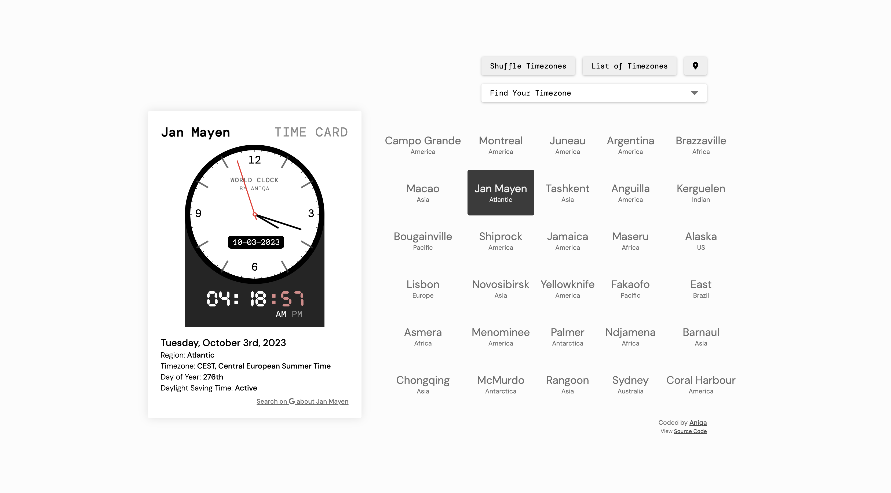

# World Clock Dashboard

An analog and digital clock for 500+ time zones. Pick a city from a shuffled grid or the full list, and see its time, date, offset and daylight saving status.

**[Live site](https://clock.aniqa.dev)**

<a href="https://clock.aniqa.dev"></a>

## Tech

- HTML, CSS and JavaScript
- [Moment Timezone](https://momentjs.com/timezone/) for time zone data and formatting
- An SVG analog clock
- A web app manifest and icons, so it can be added to your home screen

## Features

- A time card with an analog clock, digital time, the date, the day of the year, the time zone abbreviation or offset, and whether daylight saving time is on
- A grid of 30 random cities that shows each city's current time on hover; click one to load it
- "Shuffle Timezones" deals a new grid, "List of Timezones" opens a dropdown of every zone, and the location button jumps back to your own
- A link to search the selected city on Google
- Remembers your last city, or starts with your own time zone

## Design

- The time card is the focal point, with a minimal color scheme and a digital-clock typeface
- A grid of cities with hover and active states, and custom styling for the dropdown
- Picking a city scrolls back to the time card, which matters most on phones where the grid sits below it

## Project structure

- `index.html`: the page, including the SVG clock face
- `src/script.js`: time zone list, city grid, time card and clocks
- `src/styles.css`: layout and five breakpoints
- `assets/` and `manifest.json`: icons, preview image and the app manifest

## Key concepts

- **Filtering and formatting time zones.** Zones without a region (like `Etc/GMT+1`) are filtered out, and names like `America/New_York` show as New York, America.
- **Intervals that don't collide.** Each clock updates every second with `setInterval`, and switching cities clears the old interval first so two clocks never run at once.
- **Spelled-out time zones.** My own abbreviation map overrides Moment's, so "EDT" reads as "EDT, Eastern Daylight Time"; zones without a name show their offset instead.

## Setup

No build step or API keys. Serve the folder locally, since the page loads its files from root paths:

```bash
git clone https://github.com/aniqatc/world-clock.git
cd world-clock
python3 -m http.server
```

## Changelog

### November 2023

- Added the app manifest and icons, and cleaned up the time card functions

### October 2023

- Initial release
